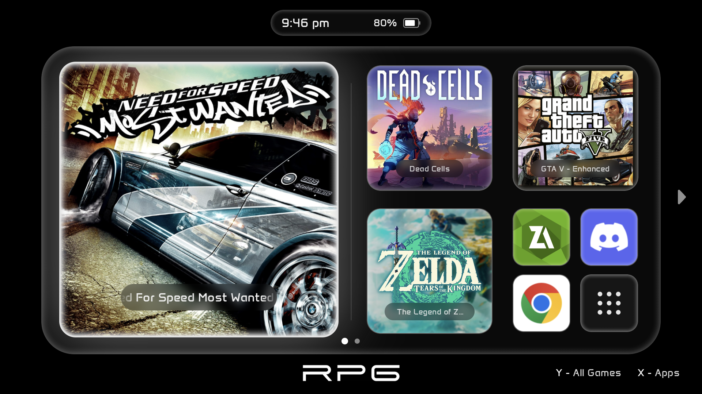
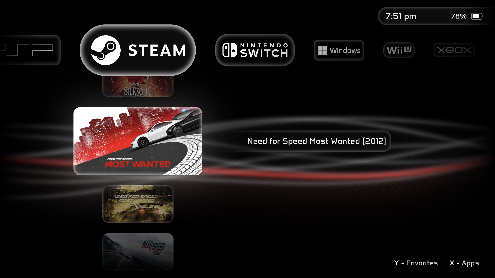
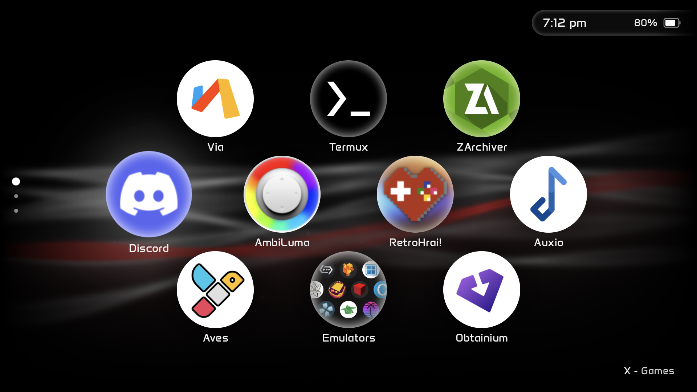
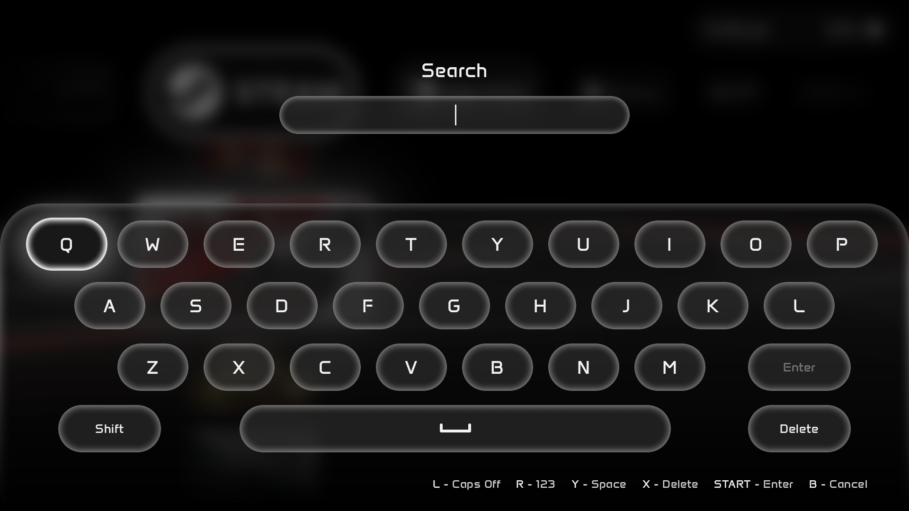
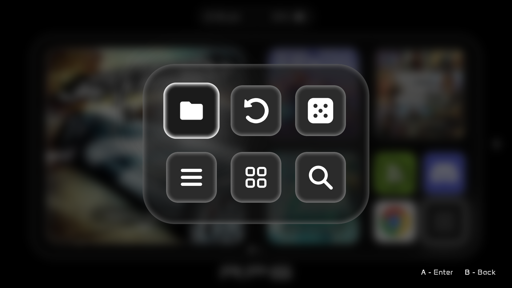
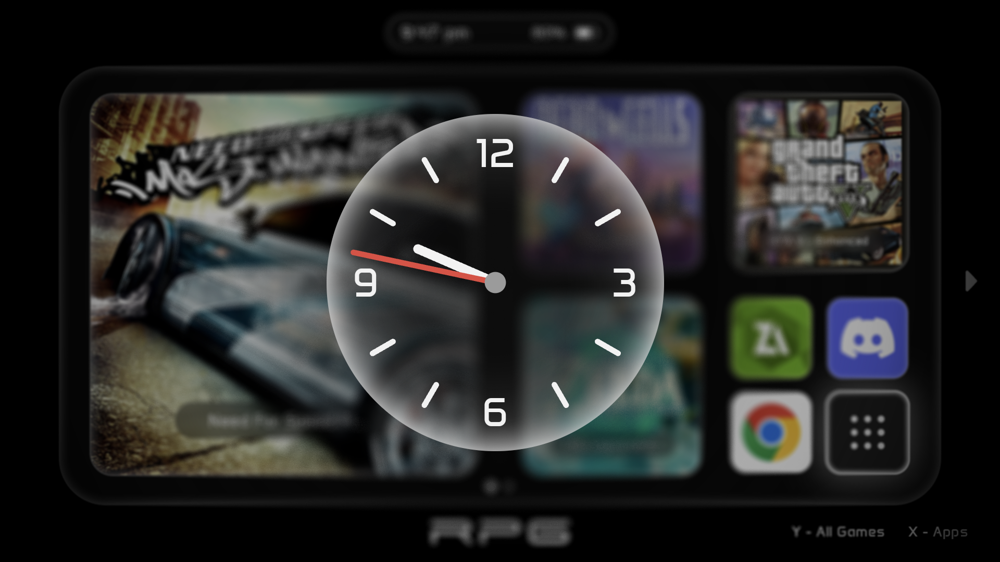
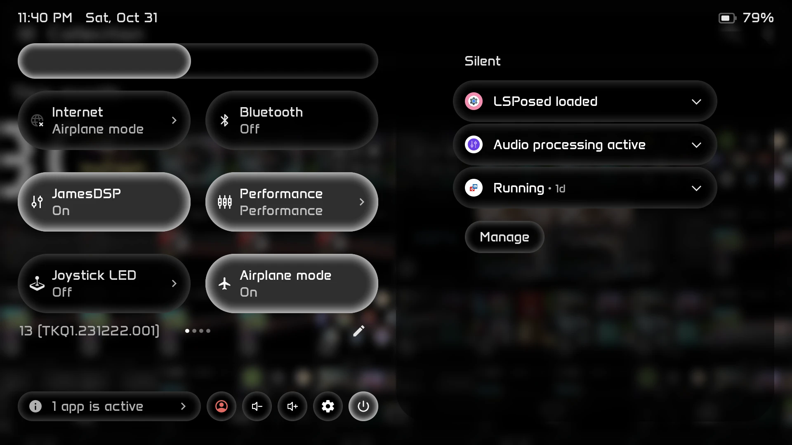
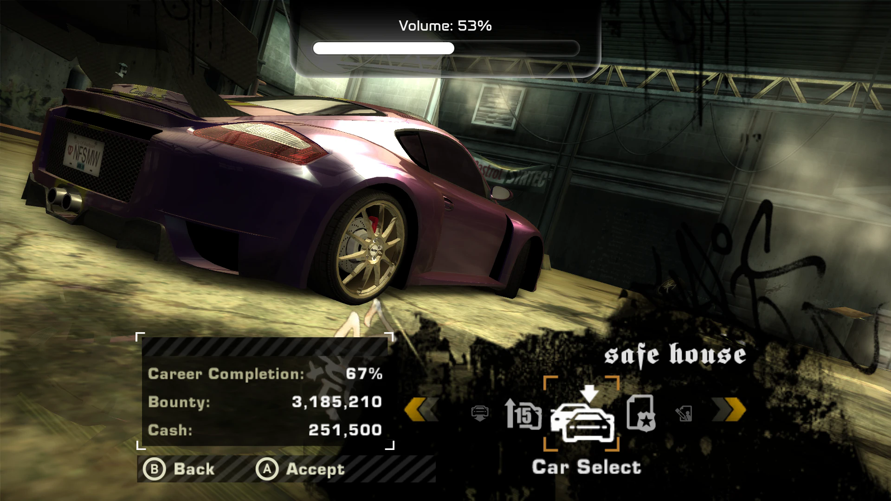

# MinimaUI
A minimalist frontend for android handhelds. 

***Minimalist Aesthetics -***  Focused to help with "choice paralysis." A simple home for your retro games with fluid animations and a polished UI, designed to end mindless scrolling through your massive game library, just click-and-play!

# Screenshots
<p>
  
  
</p>
<p>
  
  
</p>
<p>
  
  
</p>

# Minimal Load on the Battery
No -
* Online scraping,
* Discord integration,
* RetroAchievements support,
* Background processes.

When nothing has been touched for 30 seconds the focus glow and the scrolling titles stop, the wave stops, the screen dims to 60 Hz and an analog clock fades in; the first button press only wakes it.

# Features
* **Favorites**: a bento of your favorite games and apps, with folders and a recently played view.
* **All Games**: an XMB-style row of platforms with a column of covers under each one (16:9 covers).
* **Apps**: your apps in pages, separate from the games.
* **Search** (L2 + R2): type with MinimaUI's own on-screen keyboard (letters and a number pad), or with the touch screen.
* **Edit Mode**: rearrange favorites, platforms and apps; remove games from the library (and bring them back from the *Hidden Games* page of *Edit Current Platform*, in Edit Mode on All Games).
* **Per-game and per-platform emulators**: pick any installed app as the emulator, or go back to the original.
* **Platform tiles** show the platform's name as text; give a platform its own title or image if you like.
* Optional animated wave, background music, UI sounds, your own boot animation, settings backups, and an ambient clock.
* Touch, buttons or both.

# Supported platforms and emulators (for now)
More platforms and emulators will be added as feedback comes in, so please tell me what you use.

| Platform | Games | Launched with |
|---|---|---|
| Android | apps you add by hand | the app itself |
| Steam | games you add by hand (title + GameHub id) | GameHub |
| Windows | `.art` files, or shortcuts pinned from Winlator / GameHub | Artemis, the pinned shortcut |
| Nintendo Switch | `.nsp .xci .nsz .xcz .nro` | Eden |
| Nintendo 3DS | `.cci .3ds .cia` | Azahar |
| Wii U | `.wux .wud .wua` | Cemu |
| PSP | `.iso .cso .pbp` | PPSSPP / PPSSPP Gold |
| PS2 | `.chd .iso` | ArmSX2 / AetherSX2 / NetherSX2 |
| PS Vita | `.psvita` (a text file holding the game's title id) | Vita3K |
| Xbox | `.xiso .iso` | HakuX |

You can send any ROM game to a different emulator: *Start menu → Edit Current Game → Custom Emulator* (one game), or in the platform Edit Mode *Edit Current Platform → Default Emulator* (the whole platform). Press X on either to go back to the original.

MinimaUI does not include any games, BIOS files, emulators or artwork of the platforms. You bring your own.

# Installation
1. **Requirements**: Android 13 or newer, a landscape 16:9 screen (made on a Retroid Pocket 6).
2. **Install the APK** from the [Releases](../../releases) page (allow "install unknown apps" for your browser or file manager).
3. **Open MinimaUI** and allow **All files access** when asked. MinimaUI needs it to read your ROM folders and to keep its own `MinimaUI/` folder.
4. **Make it your home app** (optional): Android Settings → Apps → Default apps → Home app → MinimaUI. Pressing Home then returns to it.
5. **Add your ROM folders**: press **Start** → **ROMs Folder(s)** → the **+** pill, then pick the folder that holds your platform folders. Inside it, name one folder per platform: `PSP`, `PS2`, `Switch`, `3DS`, `WiiU`, `Vita` (or `PSV`), `Xbox`, `Android`, `Artemis` (the Windows `.art` files). Names are not case sensitive and spaces are ignored (`Nintendo Switch` works). Press **Y** on that screen to rescan whenever you add games.
6. **Add Android games and apps**: turn on **Edit Mode** (Start → Customization), then on All Games the Android and Steam rows end with a **+** (Steam games take a title and their GameHub id), and on the Apps page press **A** on an empty slot to pick an app.

# Getting around (no first-time screen needed)
| Button | What it does |
|---|---|
| D-pad | move |
| **A** | launch / enter |
| **B** | back |
| **Y** | Favorites ⇄ All Games |
| **X** | Apps ⇄ games |
| **L1 / R1**, right stick | turn pages |
| **L2 + R2** | search |
| **Start** (tap) | the menu |
| **Start** (hold) | Android's own settings |
| **Select** (tap) | details card of the focused game (time played and more) |
| **M1 / M2** | send a ripple through the wave |

The **Start menu** has four pages:
* **Edit Current Game** (or Platform / App): title, cover image, favorite, folder, custom emulator and remove from library (for a platform: icon, title and default emulator, and a second page listing the hidden games).
* **Customization**: XMB wave, touch, **Edit Mode**, UI smoothness (60 / 120 Hz), **Boot Animation**, sounds, music and volume, and which platforms are shown.
* **ROMs Folder(s)**: your ROM folders (**X** removes one, **Y** rescans).
* **Backup / Restore**: save and restore all settings.

The keyboard: **A** types, **X** deletes, **Y** is space, **Start** is Enter, **L** is Caps (or the Shift key), **R** switches between the letters and the number pad, **B** cancels.

# The MinimaUI folder
MinimaUI creates these folders on internal storage (`/sdcard/MinimaUI/`) itself the first time it runs with *All files access*:

```
MinimaUI/
  Backup/            settings backups (and Custom Wave/ for saved wave looks)
  GameID/            gamehub_games.txt  ->  one game per line: Title | id   (edit it by hand if you like)
  Music/             your own background music; pick it in Customization
  Sounds/            your own UI sounds (see below)
  Cover Art/         put your covers here and pick them from the menus
    Favorites/
    All Games/<platform>/
  Platform Icons/    optional: your own platform images (create it yourself)
  Logo.png           optional: your own logo for the bottom of Favorites
```

**Sounds**: drop files named like these in `Sounds/` (`.wav`, `.ogg` or `.mp3`); any that are missing fall back to Android's click:
`navigation`, `settings_menu_navigation`, `page_switch`, `app_launch`, `game_launch`, `app_exit`, `game_exit`, `cancel_confirm`, `keyboard`, `toast_menu`, `switch`.

Sounds are not included. If you want a PS Vita feel, the community-made [PS Vita SFX pack on DeckThemes](https://deckthemes.com/packs/view?themeId=9dab732c-e05c-4f4b-a6b4-c648a8c144d3) has the system sounds, including ones MinimaUI doesn't use. Its files are named differently from the list above, so listen to them, pick the ones you like, copy them into `Sounds/` and rename each one to the name MinimaUI expects. That pack is made by someone else and I'm not affiliated with it or with Sony; the sounds belong to their owners, so use them for your own device only.

**Boot animation**: *Customization → Boot Animation* set to CUSTOM opens a file picker; choose a video (any format Android can play, a 16:9 one fills the screen) and it plays instead of the logo every time MinimaUI starts (a button or a tap skips it). Set it back to DEFAULT to forget the video.

**The logo** at the bottom of Favorites is the MinimaUI logo. To use your own, put a PNG at `MinimaUI/Logo.png` (about 5:1 wide, light on transparent works best) and restart MinimaUI. A proper logo picker will come later.

**Covers and platform icons** are not bundled: pick your own images with *Select Cover Image* and *Edit Current Platform → Select Platform Icon*. MinimaUI never downloads artwork or metadata.

**Platform icons**: tiles show the platform's name as text until you pick an image. A big collection of console logos (many more consoles than MinimaUI supports yet) is in the [console-logos repository](https://github.com/PRO100BYTE/console-logos/tree/main/Recommended%20Versions%20%28Normal%29%20%281%20Per%20Platform%29%20v2.1). Download the ones you want (check that repository for its terms), put them in `MinimaUI/Platform Icons/`, then in Edit Mode on the All Games page open the Start menu → *Edit Current Platform → Select Platform Icon* and pick the image. The logos belong to their owners.

# The wave
The first time you run MinimaUI the XMB wave is on, in the author's own look. Change it in *Start → Customization → XMB Wave* (OFF, ON = the original wave, CUSTOM = the MinimaUI ribbon). With CUSTOM selected you can randomize it (**X**) and save the current look (**Y**) as a file in `MinimaUI/Backup/Custom Wave/`; restore one from *Backup / Restore*. The files are plain `key = value` text, so you can also tune them by hand.

# Optional extras
* **Volume and brightness bars** over other apps: MinimaUI has an accessibility service for this (Android Settings → Accessibility → MinimaUI). It's off until you enable it, and nothing else needs it.
* **[ui-overlay](ui-overlay)**: a Magisk module that gives Android's own quick settings, notifications and power menu MinimaUI's soft fading outline. Only for rooted devices, and entirely optional. See its README.

<p>
  
  
</p>

# Future Plans
* More platforms and emulators (and a menu to add your own)
* More emulator intents
* A logo picker (instead of the MinimaUI logo)
* Original default BGM
* UI polish
* Dual-screen & non 16:9 display support
* And many more yet to come!

# Feedback
Bugs, ideas, or an emulator or platform you'd like to see: open an [issue](../../issues). MinimaUI is a personal project, so I don't take code contributions; see [CONTRIBUTING.md](CONTRIBUTING.md).

# License
MinimaUI is **source-available** under the **PolyForm Strict License 1.0.0**. The code is public so you can see exactly what the app does (it needs *All files access*, and has no network features), and you can use it for any noncommercial purpose, but you may not change it, distribute it or make new works based on it. See [LICENSE](LICENSE).

Versions 2.0 and 2.0.1 were released earlier under the GNU General Public License v3.0; those two releases stay available under that license for anyone who has them. Everything after 2.0.1 is under PolyForm Strict.

# Disclaimer
* Artificial Intelligence was used in the making of this frontend. I am not familiar with Android Studio, so Claude Code makes the backend for me. However, since Kotlin (coding language used for this app) is similar to Java, which I have experience with, I optimize the code to the best of my abilities. UI design was 100% done by me, no AI was used for assets.
* All platform, emulator and game names are trademarks of their owners. MinimaUI is not affiliated with any of them.
